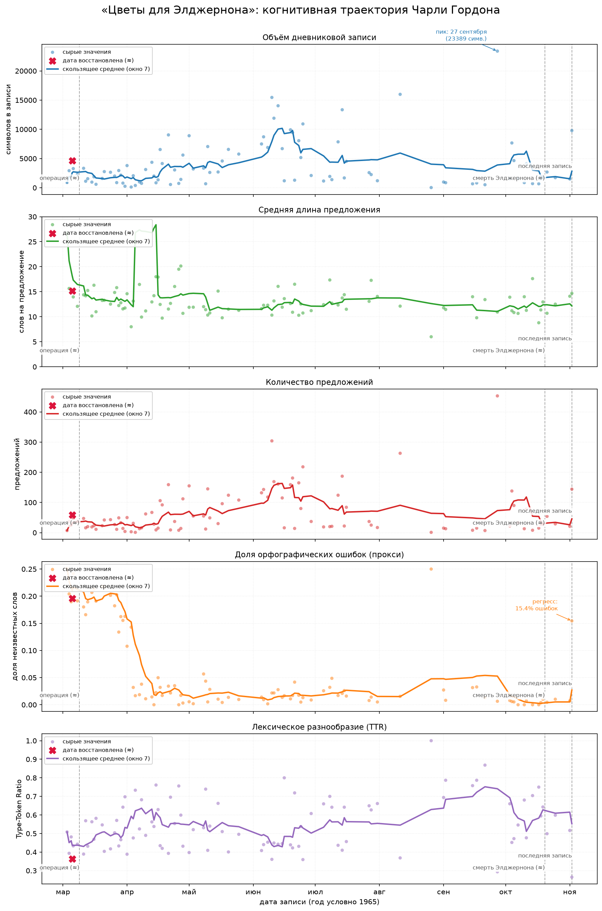
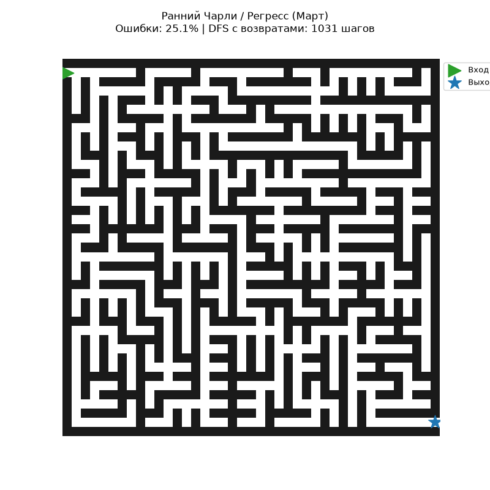
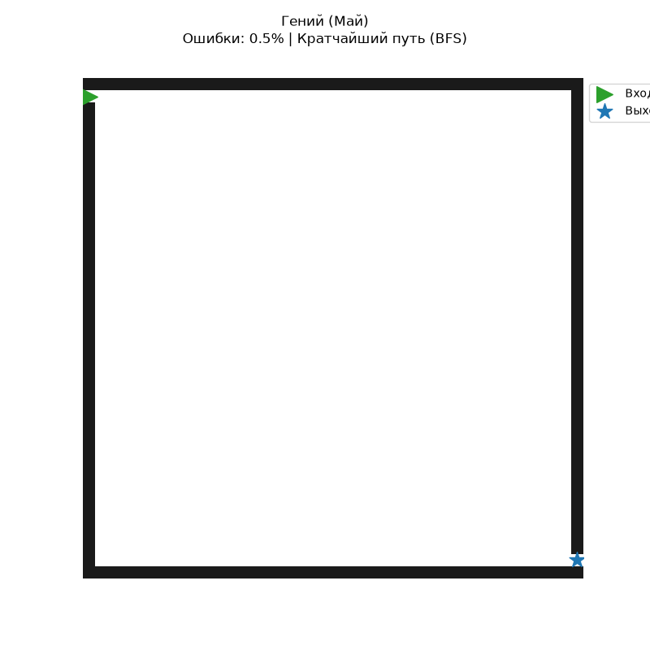
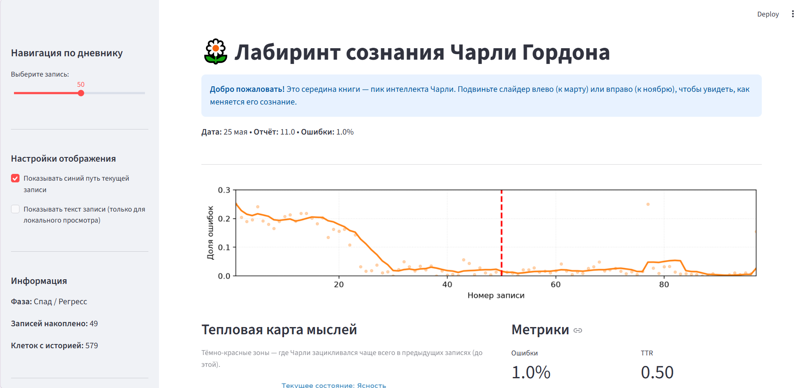
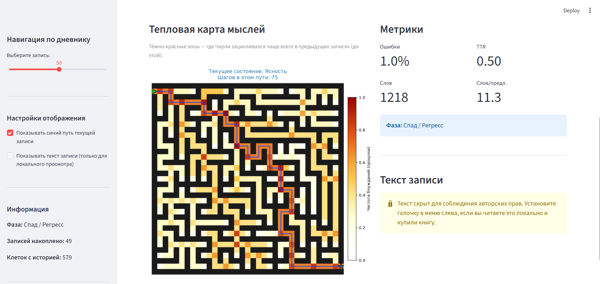

# 🌼 Verwirrung: Лабиринт сознания Чарли Гордона

> *«Я не знаю пачему но он гаварит што это важно штобы они могли увидить што я падхажу им...»* — Чарли Гордон

**Verwirrung** (нем. *замешательство, путаница*) — это исследовательский проект на стыке литературы и Data Science. Идея заключается в оцифровывании дневника Чарли Гордона из книги Дэниела Киза «Цветы для Элджернона» и визуализации его когнитивной траектории.

## Из чего состоит проект сейчас

Проект проходит полный цикл обработки данных: от парсинга сырого FB2-файла до интерактивного веб-дашборда.

1. **Парсинг FB2:** Извлечение 97 дневниковых записей с восстановлением хронологии.
2. **NLP-Метрики:** Анализ текста с помощью `pymorphy3` и `razdel`. Мы измеряем:
   * *Долю орфографических ошибок* (как прокси-показатель деградации).
   * *Лексическое разнообразие (TTR)* (показывает обогащение словарного запаса).
   * *Среднюю длину предложения* (показывает структурность мышления).
3. **Таймлайн:** Визуализация когнитивных изменений во времени.
4. **Интерактивный лабиринт:** Метафора сознания Чарли. В зависимости от уровня ошибок алгоритм блуждания по лабиринту меняется с `DFS` на `BFS`. Тепловая карта показывает «зацикливания» мыслей.

## Визуализации

### Когнитивная траектория

> *Пять графиков показывают, как растёт объём текста, падает доля ошибок и меняется лексическое разнообразие.*

### Лабиринт
| Ранний Чарли (Хаос) | Пик интеллекта (Ясность) |
| :---: | :---: |
|  |  |
> *Слева — DFS-блуждание с возвратами. Справа — BFS-поиск кратчайшего пути.*

### Интерактивный дашборд
| Титульный | Тепловая карта |
| :---: | :---: |
|  |  |
> *Streamlit-приложение позволяет двигать слайдер по дням и наблюдать, как меняется лабиринт и текст записи.*

## Как работает лабиринт

*   **Лабиринт** — это пространство сознания.
*   **Стенки** — это барьеры и тупики в процессе познания.
*   **Агент** — сам Чарли.
*   Если в записи **много ошибок** (ранний Чарли или регресс), агент использует алгоритм **DFS** (поиск в глубину). Он идёт, пока не упрётся в стену, возвращается, пробует снова — это создаёт длинный, хаотичный путь.
*   Если запись **чистая и грамотная** (гений), агент использует **BFS** (поиск в ширину) и мгновенно находит кратчайший выход из лабиринта.
